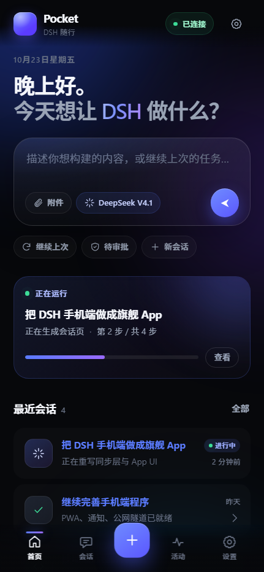
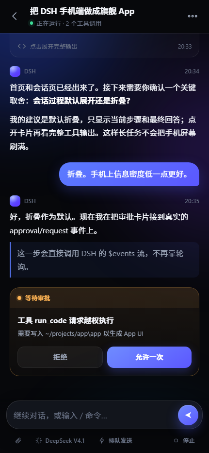
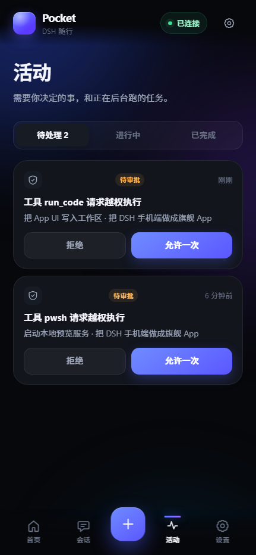
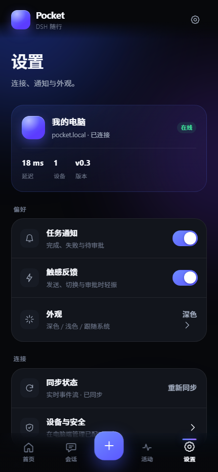
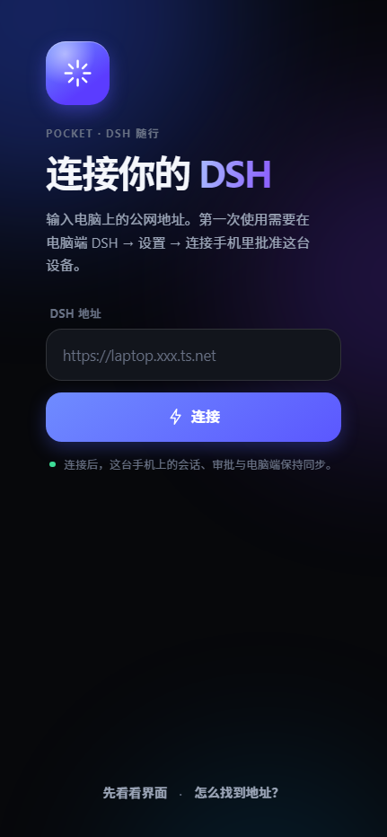

# Pocket · DSH 随行

把电脑上的 **DeepSeek Harness (DSH)** 带到手机：
看长任务进度、在消息流里直接批准工具、继续对话、收到系统通知。

> **Pocket 是 DSH 的伴生 App，不是另一个聊天机器人。**
> 它不重新实现 Agent，只消费 DSH 的 Session / 事件流 / 审批 API。

> 状态：**v0.4-dev — 真实 DSH 会话已接通**。
> 会话列表、快照 + WebSocket 增量、发消息、停止、token 级流式输出都已验证；
> Android Capacitor 工程已生成，配对引导页已加入；系统通知与签名发布还在进行。

<table>
<tr>
<td></td>
<td></td>
</tr>
</table>

## 为什么做 Pocket

原来的手机端是「桌面 Web UI + 窄屏 CSS」：能用，但不像 App，而且长任务时容易出现两个问题：

- **卡顿**：桌面布局、工具输出和滚动容器一起挤在手机上。
- **不同步**：切后台、隧道抖动或 WebSocket 断开后，页面还停在旧状态。

Pocket 的解法不是继续给桌面 UI 打补丁，而是：

1. **独立 App UI**：chat-first，首页直接继续任务，工具输出默认折叠。
2. **状态模型优先**：以 DSH 的 seq / 事件流为准，先渲染快照，再合并增量。
3. **恢复优先**：切后台、断网、隧道重连后自动重新 follow，不整页刷新。
4. **审批就地完成**：approval/request 直接出现在消息流和活动中心，一次点击结案。

## 当前能力（v0.4-dev）

- 首页 / 会话 / 活动 / 设置四栏，底部 Tab + 新会话 FAB
- 真实 DSH 数据：session/list、session/create、session/follow、session/prompt、session/cancel
- 快照 + WebSocket 增量合并，按 seq 去重，断线自动重开 follow
- token 级流式输出（reasoning 不刷屏，正文逐字出现）
- 工具卡片折叠、审批卡片、运行状态、自动标题
- 过滤 runtime-context / skill-catalog / time-context 等注入消息，只显示人类消息
- 深色 / 浅色主题、安全区、减少动效、键盘适配
- PWA manifest / Service Worker / 离线壳
- Gateway 新增 `/__dshapp/` 静态路由，可直接从公网 HTTPS 地址安装 PWA
- 网关 39 项单测 + App 14 项传输/时间线测试通过

**还在进行**：审批 waterfall 的端到端真机验证、配对引导页、系统通知、Capacitor Android 打包。
当前 app.js 在没有设备 cookie 时会回退到演示数据，方便看设计。

## 架构

~~~text
┌─────────────┐      HTTPS / WSS       ┌──────────────────┐
│  Pocket App │ ─────────────────────▶ │  dsh-mobile 网关  │
│  PWA/APK    │  device cookie         │  127.0.0.1:8470   │
└─────────────┘                        └────────┬─────────┘
                                                 │ 注入上游 cookie
                                                 ▼
                                        ┌──────────────────┐
                                        │  DSH Web Host    │
                                        │  Session / Event │
                                        └──────────────────┘
~~~

- **App**：静态 HTML/CSS/JS，无构建步骤；可直接作为 PWA，也可被 Capacitor 装进 Android。
- **Gateway**：现有 dsh-mobile 插件，负责配对、设备令牌、反向代理、推送和公网入口。
- **DSH Host**：会话与 Agent 的唯一事实源；Pocket 只读/写它的 HTTP RPC 与 WebSocket 事件流。

## 本地预览 UI

~~~powershell
# 终端 1：启动静态预览（默认 127.0.0.1:8788）
node .\scripts\serve-app.mjs .\app 8788
~~~

打开 <http://127.0.0.1:8788/>。预览服务器会把 `/api` 和 `/__dshm` 代理到本机 8470 网关：
如果浏览器已经配对，会显示真实会话；没有设备 cookie 时回退到演示数据。

## 安装到 DSH（现有网关）

~~~powershell
powershell -ExecutionPolicy Bypass -File .\scripts\install.ps1
# 然后完全退出并重新打开 DSH
powershell -ExecutionPolicy Bypass -File .\scripts\check.ps1
~~~

配对与公网入口见 [docs/remote-domain.md](docs/remote-domain.md)。
重启 DSH 后，手机打开 **https://你的地址/__dshapp/** 即可使用 Pocket 并安装到主屏幕。
完整的桌面 UI 仍在根路径，高级功能（终端、文件树）可以继续走桌面 UI。

## Android

~~~powershell
cd mobile
npm ci
npm run build:web
npx cap sync android
npx cap open android
~~~

本机没有 JDK / Android SDK 时，用 GitHub Actions 构建：
推送 tag（例如 v0.4.0）或手动运行 **android** workflow，会产出 `pocket-debug-apk` artifact。

Android 壳首次启动会显示「连接你的 DSH」：输入公网 HTTPS 地址后，WebView 会导航到该地址下的 `/__dshapp/`，
因此 cookie、Service Worker 与配对流程都与 PWA 完全一致。

## 建立 GitHub 仓库

本机 `gh` 登录后执行：

~~~powershell
powershell -ExecutionPolicy Bypass -File .\scripts\create-github-repo.ps1
~~~

默认创建 public 仓库 `dsh-pocket`，推送 main，并设置 topics。
也可以手动：`gh auth login` → `gh repo create dsh-pocket --public --source . --remote origin --push`。

## 开发

~~~powershell
# 网关单测
cd dsh-mobile
npm ci
npm test

# 真实实例联调（不影响正在用的 DSH）
$env:DSH_MOBILE_PORT = '8471'
powershell -ExecutionPolicy Bypass -File ..\scripts\dev-host.ps1
$env:DSH_GW = 'http://127.0.0.1:8471'
node .\tests\live-check.mjs
~~~

## 路线图

| 版本 | 内容 |
|---|---|
| v0.3 | 高保真 UI + 交互原型 + 设计系统（当前） |
| v0.4 | 接真实 session/list、session/follow、session/prompt、$events |
| v0.5 | 断线恢复、离线缓存、通知、审批闭环、活动中心 |
| v0.6 | Capacitor Android、启动图、原生通知、分享入口 |
| v1.0 | 引导页、多语言、可访问性、性能与安全审计、Release |

详见 [docs/product/APP_SPEC.md](docs/product/APP_SPEC.md) 与 [docs/product/SYNC.md](docs/product/SYNC.md)。

## 安全模型

- 手机只持有设备 cookie；不接触 DSH launch token / 上游签名 cookie。
- 公网必须 HTTPS；HTTP 仅限可信局域网。
- 审批结果只允许一次；不实现「永久允许」。
- 通知默认只显示工具名与会话标题，不推送完整命令或文件内容。
- 设备可在电脑端单独吊销，吊销后 WebSocket 立即断开。

## 许可与声明

MIT License。见 [LICENSE](LICENSE)。

Pocket 是社区项目，**不是 DeepSeek 官方产品**。
DSH（DeepSeek Harness）及其相关商标、代码归其所有者所有；本仓库不包含 DSH 的闭源实现。